# TÀI LIỆU ĐẶC TẢ USE CASE HỆ THỐNG OMNIPOS
## HỆ THỐNG QUẢN LÝ BÁN HÀNG (POS), TỒN KHO THỜI GIAN THỰC & CÔNG NỢ VỤ NUÔI ĐẠI LÝ VẬT TƯ THỦY SẢN

- **Tên dự án**: OmniPOS (Aquaculture Supply POS & ERP)
- **Phiên bản tài liệu**: 1.0.0
- **Ngày phát hành**: 29/10/2026
- **Trạng thái**: Đã phê duyệt & Khớp với 18 màn hình hệ thống

---

## MỤC LỤC
1. [Giới Thiệu & Phạm Vi Hệ Thống](#1-giới-thiệu--phạm-vi-hệ-thống)
2. [Danh Sách Tác Nhân Hệ Thống (Actors)](#2-danh-sách-tác-nhân-hệ-thống-actors)
3. [Sơ Đồ Use Case Tổng Thể (Use Case Diagram)](#3-sơ-đồ-use-case-tổng-thể-use-case-diagram)
4. [Bảng Tổng Hợp Mã Use Case Theo Phân Hệ](#4-bảng-tổng-hợp-mã-use-case-theo-phân-hệ)
5. [Đặc Tả Chi Tiết Từng Use Case](#5-đặc-tả-chi-tiết-từng-use-case)
   - [Phân hệ 1: Bán Hàng POS Siêu Tốc & Quầy Thu Ngân](#phân-hệ-1-bán-hàng-pos-siêu-tốc--quầy-thu-ngân)
   - [Phân hệ 2: Khách Hàng, Ao Nuôi & Công Nợ Vụ Nuôi (Crop Credit)](#phân-hệ-2-khách-hàng-ao-nuôi--công-nợ-vụ-nuôi-crop-credit)
   - [Phân hệ 3: Kỹ Thuật Xét Nghiệm Nước & Kê Đơn Thuốc Ao Nuôi](#phân-hệ-3-kỹ-thuật-xét-nghiệm-nước--kê-đơn-thuốc-ao-nuôi)
   - [Phân hệ 4: Hàng Hóa, Số Lô - Hạn Dùng (FEFO) & Thẻ Kho Bất Biến](#phân-hệ-4-hàng-hóa-số-lô---hạn-dùng-fefo--thẻ-kho-bất-biến)
   - [Phân hệ 5: Nhập Hàng NCC (Giá Vốn MAC) & Điều Chuyển Kho Vệ Tinh](#phân-hệ-5-nhập-hàng-ncc-giá-vốn-mac--điều-chuyển-kho-vệ-tinh)
   - [Phân hệ 6: Kiểm Kê Kho & Xử Lý Đổi Trả Hoàn Kho](#phân-hệ-6-kiểm-kê-kho--xử-lý-đổi-trả-hoàn-kho)
   - [Phân hệ 7: Quản Lý Ca Làm Việc & Báo Cáo Tài Chính Real-time](#phân-hệ-7-quản-lý-ca-làm-việc--báo-cáo-tài-chính-real-time)
   - [Phân hệ 8: Nhân Sự, Phân Quyền PIN Guardrails & Cài Đặt Hệ Thống](#phân-hệ-8-nhân-sự-phân-quyền-pin-guardrails--cài-đặt-hệ-thống)
6. [Ma Trận Phân Quyền Theo Vai Trò (Traceability Matrix)](#6-ma-trận-phân-quyền-theo-vai-trò-traceability-matrix)

---

## 1. GIỚI THIỆU & PHẠM VI HỆ THỐNG

### 1.1. Mục Tiêu
OmniPOS là phần mềm chuyên biệt phục vụ vận hành chuỗi và đại lý bán lẻ vật tư nông nghiệp - nuôi trồng thủy sản (nuôi tôm thẻ chân trắng, tôm sú, cá tra, cá lồng bè). Hệ thống giải quyết 4 bài toán sống còn của ngành:
1. **Bán hàng quầy siêu tốc (Offline-first)** với phím tắt F1-F9, quét barcode, quy đổi đơn vị tính sỉ - lẻ đa cấp (Thùng ➔ Chai, Bao ➔ Kg).
2. **Quản trị công nợ vụ nuôi (Crop Credit)**: Cho phép nông dân mua chịu gối đầu thức ăn, thuốc, hóa chất từ đầu vụ đến cuối vụ (3 - 6 tháng) mới thanh toán khi thu hoạch tôm; quản lý hạn mức tín dụng và thu nợ từng đợt bán tỉa.
3. **Quản lý Số Lô (Batch/Lot) & Hạn sử dụng theo chuẩn FEFO (First Expired, First Out)**: Loại bỏ triệt để rủi ro xuất bán thuốc/chế phẩm sinh học hết date làm chết ao tôm.
4. **Phòng Lab Ao Nuôi & Kê Đơn Thuốc Tự Động**: Kỹ sư đo độ mặn, pH, kiềm, khí độc ($NO_2, NH_3$), soi bệnh tôm và 1-click chuyển đơn thuốc thành giỏ hàng POS.

### 1.2. Phạm Vi Nghiệp Vụ
Hệ thống bao gồm 18 màn hình nghiệp vụ kết nối liền mạch từ quầy bán hàng cảm ứng (POS), phòng xét nghiệm nước đầm tôm, kho bãi trung tâm, kho vệ tinh ven sông cho đến hệ thống báo cáo tài chính đối soát két tiền mặt và cổng chuyển khoản VietQR Napas247.

---

## 2. DANH SÁCH TÁC NHÂN HỆ THỐNG (ACTORS)

| STT | Tác Nhân (Actor) | Mô Tả Vai Trò & Trách Nhiệm |
|---|---|---|
| 1 | **Thu Ngân (Cashier)** | Nhân sự trực tại quầy POS. Thực hiện quét mã barcode, chọn đơn vị tính, chọn phương thức thanh toán (VietQR, Tiền mặt, Thẻ, Bán nợ vụ), in hóa đơn K80, mở/đóng ca két tiền. |
| 2 | **Kỹ Sư Thủy Sản (Aquaculture Engineer)** | Kỹ thuật viên phụ trách xét nghiệm mẫu nước ao đầm, chẩn đoán bệnh tôm cá, lập phác đồ kê đơn thuốc và đẩy đơn sang quầy POS; đồng thời có thể bán hàng và tư vấn khách quen. |
| 3 | **Thủ Kho (Storekeeper)** | Quản lý kho hàng vật lý, lập phiếu nhập kho NCC, cập nhật số Lô/Date, tính giá vốn MAC, thực hiện kiểm kê kho, điều chuyển hàng đi kho vệ tinh ven đầm. |
| 4 | **Chủ Đại Lý / Quản Trị Viên (Admin / Store Owner)** | Có toàn quyền quản trị cao nhất: phê duyệt bán nợ vượt hạn mức tín dụng, cấu hình Guardrails (mức chiết khấu tối đa, quyền hủy bill), xem báo cáo lãi gộp, quản lý nhà cung cấp, cấu hình in K80. |
| 5 | **Khách Hàng / Chủ Đầm Tôm (Customer / Farmer)** | Người nuôi tôm cá mua vật tư. Tương tác gián tiếp: ký biên bản nhận nợ vụ, nhận toa thuốc ao nuôi, quét mã VietQR thanh toán, nhận điểm tích lũy thành viên. |
| 6 | **Hệ Thống Thanh Toán VietQR (Napas247 Gateway)** | Hệ thống ngoài (External System): Tự động sinh mã VietQR động theo số tiền đơn hàng, thông báo biến động số dư và tự động gạch nợ / khớp đơn tức thì (0ms). |
| 7 | **Thiết Bị Ngoại Vi (Hardware Devices)** | Máy quét mã vạch (Barcode Scanner), Máy in nhiệt K80 (Thermal Printer ESC/POS), Ngăn kéo đựng tiền tự động (Cash Drawer), Thiết bị quẹt thẻ ngân hàng (POS Card Reader). |

---

## 3. SƠ ĐỒ USE CASE TỔNG THỂ (USE CASE DIAGRAM)

```mermaid
flowchart TD
    subgraph Actors["Tác Nhân Hệ Thống"]
        Cashier["Thu Ngân Quầy"]
        Engineer["Kỹ Sư Thủy Sản"]
        Storekeeper["Thủ Kho"]
        Admin["Chủ Đại Lý (Admin)"]
        BankSys["Cổng VietQR Napas247"]
    end

    subgraph POS_Module["Phân Hệ Quầy Thu Ngân POS"]
        UC01["UC-01: Đăng Nhập PIN & Mở Ca"]
        UC02["UC-02: Bán Hàng Siêu Tốc (Barcode/Phím F1-F9)"]
        UC03["UC-03: Bán Hàng Ghi Nợ Vụ Nuôi"]
        UC04["UC-04: Thanh Toán VietQR Động"]
        UC05["UC-05: Quy Đổi Đơn Vị Tính Sỉ - Lẻ"]
        UC06["UC-06: In Hóa Đơn Nhiệt K80"]
    end

    subgraph Lab_Module["Phân Hệ Kỹ Thuật & Ao Nuôi"]
        UC07["UC-07: Đo Đạc Chỉ Số Nước Ao"]
        UC08["UC-08: Kê Đơn Thuốc Thủy Sản"]
        UC09["UC-09: 1-Click Chuyển Toa Vào Giỏ POS"]
    end

    subgraph Debt_Module["Phân Hệ Khách Hàng & Công Nợ"]
        UC10["UC-10: Quản Lý Hồ Sơ Khách & Đầm Ao"]
        UC11["UC-11: Theo Dõi Sổ Nợ Vụ (Crop Credit)"]
        UC12["UC-12: Lập Phiếu Thu Nợ (Gạch Nợ Đợt Bán Tôm)"]
    end

    subgraph Inventory_Module["Phân Hệ Kho & Lô - Hạn Dùng"]
        UC13["UC-13: Quản Lý Lô & Cảnh Báo Date (FEFO)"]
        UC14["UC-14: Tra Cứu Thẻ Kho Bất Biến"]
        UC15["UC-15: Nhập Hàng NCC & Tính Giá Vốn MAC"]
        UC16["UC-16: Kiểm Kê & Cân Bằng Tồn Kho"]
        UC17["UC-17: Điều Chuyển Hàng Kho Vệ Tinh"]
        UC18["UC-18: Xử Lý Đổi / Trả Hàng Hoàn Kho"]
    end

    subgraph Admin_Module["Phân Hệ Tài Chính & Quản Trị"]
        UC19["UC-19: Đối Soát Két Tiền & Đóng Ca"]
        UC20["UC-20: Xem Báo Cáo Doanh Thu & Lãi Gộp"]
        UC21["UC-21: Cấp Mã PIN & Phân Quyền Guardrails"]
        UC22["UC-22: Thiết Kế & Cài Đặt Mẫu In K80"]
        UC23["UC-23: Quản Lý Nhà Cung Cấp & Nợ Hãng"]
        UC24["UC-24: Quản Lý Bảo Hành Máy Móc Theo Serial"]
    end

    Cashier --> UC01
    Cashier --> UC02
    Cashier --> UC03
    Cashier --> UC04
    Cashier --> UC05
    Cashier --> UC06
    Cashier --> UC18
    Cashier --> UC19

    Engineer --> UC01
    Engineer --> UC07
    Engineer --> UC08
    Engineer --> UC09
    Engineer --> UC02
    Engineer --> UC03

    Storekeeper --> UC13
    Storekeeper --> UC14
    Storekeeper --> UC15
    Storekeeper --> UC16
    Storekeeper --> UC17
    Storekeeper --> UC24

    Admin --> UC03
    Admin --> UC11
    Admin --> UC12
    Admin --> UC15
    Admin --> UC19
    Admin --> UC20
    Admin --> UC21
    Admin --> UC22
    Admin --> UC23

    UC04 -.-> BankSys
```

---

## 4. BẢNG TỔNG HỢP MÃ USE CASE THEO PHÂN HỆ

| Phân Hệ Nghiệp Vụ | Mã UC | Tên Use Case | Tác Nhân Chính | Mức Độ Ưu Tiên |
|---|---|---|---|---|
| **1. Quầy Thu Ngân POS** | `UC-POS-01` | Đăng nhập mã PIN cảm ứng & Khai báo tiền đầu ca | Thu ngân, Kỹ sư | Bắt buộc (P0) |
| | `UC-POS-02` | Quét mã vạch & Bán hàng tốc độ cao (Phím F1-F9) | Thu ngân, Kỹ sư | Bắt buộc (P0) |
| | `UC-POS-03` | Bán hàng ghi nợ vụ nuôi (Ghi nợ chủ đầm) | Thu ngân, Admin | Bắt buộc (P0) |
| | `UC-POS-04` | Thanh toán VietQR động khớp tự động (Napas247) | Thu ngân, Hệ thống Bank | Bắt buộc (P0) |
| | `UC-POS-05` | Quy đổi đơn vị tính sỉ - lẻ trực tiếp trên giỏ hàng | Thu ngân | Bắt buộc (P0) |
| | `UC-POS-06` | In phiếu hóa đơn nhiệt K80 | Thu ngân | Bắt buộc (P0) |
| **2. Khách Hàng & Nợ Vụ** | `UC-CRM-01` | Quản lý hồ sơ chủ đầm & Danh mục ao nuôi | Kỹ sư, Admin | Quan trọng (P1) |
| | `UC-CRM-02` | Theo dõi sổ công nợ vụ nuôi & Hạn mức tín dụng | Admin, Thu ngân | Bắt buộc (P0) |
| | `UC-CRM-03` | Lập phiếu thu nợ (Gạch nợ từng đợt cân tôm) | Thu ngân, Admin | Bắt buộc (P0) |
| **3. Kỹ Thuật Lab Ao** | `UC-LAB-01` | Lập phiếu xét nghiệm mẫu nước ao nuôi | Kỹ sư Thủy sản | Bắt buộc (P0) |
| | `UC-LAB-02` | Chẩn đoán bệnh phẩm tôm cá & Lập phác đồ điều trị | Kỹ sư Thủy sản | Bắt buộc (P0) |
| | `UC-LAB-03` | Nạp đơn thuốc 1-click chuyển thẳng vào Giỏ POS | Kỹ sư, Thu ngân | Bắt buộc (P0) |
| **4. Kho & Lô - Hạn Dùng** | `UC-INV-01` | Quản lý Số Lô & Đèn cảnh báo hạn dùng FEFO | Thủ kho, Admin | Bắt buộc (P0) |
| | `UC-INV-02` | Tra cứu lịch sử thẻ kho bất biến (Audit Trail) | Thủ kho, Admin | Bắt buộc (P0) |
| | `UC-INV-03` | Tạo mặt hàng vật tư, ma trận biến thể & in tem | Thủ kho, Admin | Quan trọng (P1) |
| **5. Nhập Hàng & Chuyển Kho**| `UC-PUR-01` | Lập phiếu nhập kho NCC & Tự động tính giá vốn MAC | Thủ kho, Admin | Bắt buộc (P0) |
| | `UC-PUR-02` | Lập phiếu điều chuyển hàng đi kho vệ tinh ven đầm | Thủ kho | Quan trọng (P1) |
| **6. Kiểm Kê & Đổi Trả** | `UC-STK-01` | Quét mã kiểm kê & Tự động cân bằng tồn kho | Thủ kho, Admin | Bắt buộc (P0) |
| | `UC-RET-01` | Xử lý đổi / trả hàng theo hóa đơn cũ & Hoàn kho | Thu ngân, Thủ kho | Quan trọng (P1) |
| **7. Ca Làm Việc & Tài Chính** | `UC-SHF-01` | Kiểm đếm két tiền thực tế & Đóng ca làm việc | Thu ngân, Admin | Bắt buộc (P0) |
| | `UC-SHF-02` | Xem báo cáo doanh thu & Lợi nhuận gộp real-time | Admin | Bắt buộc (P0) |
| **8. Quản Trị Hệ Thống** | `UC-SYS-01` | Cấp mã PIN nhân sự & Cấu hình Guardrails | Admin | Bắt buộc (P0) |
| | `UC-SYS-02` | Cấu hình & In thử mẫu hóa đơn K80 | Admin | Quan trọng (P1) |
| | `UC-SYS-03` | Quản lý nhà cung cấp & Sổ nợ phải trả hãng | Admin | Quan trọng (P1) |
| | `UC-SYS-04` | Quản lý thiết bị máy móc & Bảo hành theo Serial | Thủ kho, Admin | Quan trọng (P1) |

---

## 5. ĐẶC TẢ CHI TIẾT TỪNG USE CASE

### Phân hệ 1: Bán Hàng POS Siêu Tốc & Quầy Thu Ngân

---

#### Use Case: `UC-POS-01` - Đăng Nhập Mã PIN Cảm Ứng & Khai Báo Mở Ca
- **Màn hình liên kết**: `/auth/pin-login`
- **Tác nhân chính**: Thu ngân, Kỹ sư thủy sản.
- **Mô tả**: Nhân viên chọn tên danh tính, nhập mã PIN 4 số trên bàn phím cảm ứng numpad và khai báo số dư tiền mặt ban đầu trong két tiền để bắt đầu phiên bán hàng mới.
- **Tiền điều kiện (Preconditions)**: Hệ thống đang ở trạng thái chưa mở ca hoặc ca trước đã kết ca hoàn tất.
- **Luồng sự kiện chính (Main Flow)**:
  1. Người dùng chọn hồ sơ nhân sự của mình (Minh Anh, Hoàng Nam, Thảo Vy...).
  2. Người dùng chạm các phím số trên Numpad cảm ứng (hoặc quẹt thẻ từ RFID/nhập bàn phím).
  3. Hệ thống hiển thị trạng thái 4 chấm LED tròn bảo mật.
  4. Hệ thống xác thực mã PIN trùng khớp trong cơ sở dữ liệu.
  5. Người dùng kiểm tra thông tin ca trực (Ca sáng 08:00 - 15:00, Chi nhánh Bến Tre).
  6. Người dùng nhập số tiền mặt có sẵn trong két tiền (Starting Cash, ví dụ: `2.000.000₫`) và ghi chú bàn giao.
  7. Người dùng nhấn nút **"Xác Nhận & Mở Ca Bán Hàng"** (hoặc bấm `Enter`).
  8. Hệ thống khởi tạo bản ghi `ShiftSession`, ghi nhận thời gian bắt đầu và chuyển hướng trực tiếp vào màn hình `/pos/terminal`.
- **Luồng ngoại lệ (Exceptions)**:
  - *Sai mã PIN*: Hệ thống rung đỏ 4 chấm LED, thông báo "Mã PIN không chính xác, vui lòng thử lại" và xóa trường nhập.
  - *Chưa nhập tiền két*: Hệ thống cảnh báo yêu cầu khai báo số tiền mặt đầu ca để phục vụ đối soát đóng ca.
- **Hậu điều kiện (Postconditions)**: Phiên làm việc được mở thành công, két tiền ghi nhận số dư đầu kỳ.

---

#### Use Case: `UC-POS-02` - Quét Mã Vạch & Bán Hàng Tốc Độ Cao
- **Màn hình liên kết**: `/pos/terminal`
- **Tác nhân chính**: Thu ngân, Kỹ sư thủy sản.
- **Mô tả**: Nhân viên sử dụng máy quét mã vạch hoặc phím tắt bàn phím F1-F9 để chọn sản phẩm, điều chỉnh số lượng và hoàn tất bán lẻ hàng hóa.
- **Luồng sự kiện chính (Main Flow)**:
  1. Người dùng bấm `F4` để kích hoạt con trỏ vào ô quét mã vạch Barcode.
  2. Đầu quét mã vạch đọc mã trên bao bì sản phẩm (ví dụ: `8936012445892` hoặc mã SKU `YUC-LIQ-1L`).
  3. Hệ thống tra cứu sản phẩm trong bộ nhớ đệm (Dexie/Zustand Cache) với độ trễ 0ms.
  4. Hệ thống tự động thêm sản phẩm vào Giỏ hàng của tab đơn hiện tại (`Đơn #1 [F1]`):
     - Nếu sản phẩm đã có: tự động tăng số lượng (`+1`).
     - Nếu sản phẩm mới: thêm dòng mới với đơn giá niêm yết và số Lô/Hạn dùng mặc định theo FEFO.
  5. Người dùng có thể nhấn `+` / `-` hoặc gõ số lượng trực tiếp.
  6. Người dùng bấm `F3` nếu muốn tạo đơn mới song song khi khách hàng khác cần thanh toán gấp; bấm `F1`/`F2` để chuyển đổi qua lại giữa các đơn đang chờ mà không mất giỏ hàng.
  7. Người dùng kiểm tra tổng tiền tạm tính, giảm giá thành viên [F7].
  8. Người dùng nhấn nút **"Thanh Toán & In Bill [F9]"**.
  9. Hệ thống gửi lệnh in hóa đơn nhiệt tới máy in K80, trừ số lượng tồn kho khả dụng và làm mới giỏ hàng sẵn sàng cho đơn tiếp theo.
- **Quy tắc nghiệp vụ**: Hàng hóa có tồn kho = 0 vẫn được phép bán nếu hệ thống bật chế độ "Cho phép xuất âm có cảnh báo", ngược lại sẽ báo lỗi hết hàng.

---

#### Use Case: `UC-POS-03` - Bán Hàng Ghi Nợ Vụ Nuôi (Aquaculture Crop Credit)
- **Màn hình liên kết**: `/pos/terminal`
- **Tác nhân chính**: Thu ngân, Chủ đại lý (Admin), Khách hàng (Chủ đầm).
- **Mô tả**: Cho phép khách hàng là chủ ao nuôi tôm lấy thức ăn, thuốc, khoáng tạt theo hình thức mua nợ gối đầu đến cuối vụ mới thanh toán.
- **Tiền điều kiện (Preconditions)**: Khách hàng đã được tạo hồ sơ trong hệ thống và có thiết lập Hạn mức tín dụng (Credit Limit).
- **Luồng sự kiện chính (Main Flow)**:
  1. Thu ngân tạo đơn hàng vật tư trên giỏ hàng POS (thức ăn tôm, vi sinh, vôi, khoáng...).
  2. Thu ngân bấm **"+ Chọn chủ đầm"** và chọn khách hàng (ví dụ: `Anh Ba Hùng - 0918.455.789`).
  3. Hệ thống hiển thị: Hạng thành viên, Hạn mức nợ (`150.000.000₫`) và Dư nợ hiện tại (`68.500.000₫`).
  4. Thu ngân chọn đích danh **Ao nuôi nhận hàng** (ví dụ: `Ao Số 1 - Lót bạt 3.000m² - Vụ 1/2026`).
  5. Tại khu vực thanh toán, Thu ngân chọn phương thức **"Bán Nợ Vụ"**.
  6. Hệ thống kiểm tra điều kiện tín dụng:
     $$\text{Dư nợ mới} = \text{Dư nợ hiện tại} + \text{Giá trị đơn này} \le \text{Hạn mức tín dụng}$$
  7. Thu ngân nhấn **"Xác Nhận Nợ & In Phiếu [F9]"**.
  8. Hệ thống ghi nhận đơn hàng với trạng thái `COMPLETED (Ghi nợ vụ)`:
     - Tạo bản ghi xuất kho trừ tồn sản phẩm.
     - Tạo bản ghi công nợ trong `CropDebtLedger` gắn với Khách hàng và Ao số 1.
     - Cập nhật số dư nợ lũy kế của khách hàng.
  9. Máy in K80 in hóa đơn bán hàng có mục **"THEO DÕI NỢ VỤ NUÔI"** hiển thị: Nợ cũ, Đơn này, Nợ mới và chữ ký biên nhận của chủ đầm.
- **Luồng ngoại lệ (Vượt hạn mức tín dụng)**:
  - Nếu $\text{Dư nợ mới} > \text{Hạn mức tín dụng}$: Hệ thống bật hộp thoại cảnh báo: *"Khách hàng đã vượt hạn mức nợ cho phép. Yêu cầu mã PIN Quản trị viên để duyệt xuất nợ!"*.
  - Admin nhập mã PIN xác nhận ➔ Cho phép xuất nợ.
  - Admin từ chối ➔ Thu ngân yêu cầu khách thanh toán một phần bằng tiền mặt/VietQR để giảm dư nợ.

---

#### Use Case: `UC-POS-04` - Thanh Toán VietQR Động Khớp Tự Động (Napas247)
- **Màn hình liên kết**: `/pos/terminal`
- **Tác nhân chính**: Thu ngân, Khách hàng, Cổng Napas247.
- **Luồng sự kiện chính**:
  1. Thu ngân chọn phương thức **"VietQR"**.
  2. Hệ thống tạo mã QR chuẩn VietQR động chứa: Mã ngân hàng (VCB), Số tài khoản đại lý, Số tiền chính xác đến từng đồng (ví dụ: `1.610.000₫`) và Nội dung chuyển khoản duy nhất (`OMNIPOS POS1049`).
  3. Khung ngắm VietQR hiển thị đồng hồ đếm ngược `02:45s` và trạng thái `Đang chờ quét`.
  4. Khách hàng mở ứng dụng ngân hàng quét mã QR và xác nhận chuyển khoản.
  5. Cổng Napas247 bắn Webhook thông báo giao dịch thành công.
  6. Màn hình POS chuyển sang trạng thái xanh `Đã khớp tiền tự động (100%)`.
  7. Hệ thống tự động in hóa đơn và đóng đơn hàng mà không cần thu ngân bấm thêm phím nào.

---

#### Use Case: `UC-POS-05` - Quy Đổi Đơn Vị Tính Sỉ - Lẻ Trực Tiếp Trên Quầy
- **Màn hình liên kết**: `/pos/terminal`
- **Tác nhân chính**: Thu ngân.
- **Mô tả**: Cho phép linh hoạt chọn bán nguyên bao/thùng hoặc xé lẻ ký/chai trực tiếp trên cùng một dòng giỏ hàng.
- **Luồng sự kiện chính**:
  1. Thu ngân quét mã vạch bao thức ăn tôm 25kg (Đơn vị gốc: `Bao`, Giá: `680.000₫`).
  2. Khách hàng muốn mua lẻ 5kg.
  3. Tại dòng sản phẩm trong giỏ hàng, Thu ngân nhấp vào ô đơn vị tính và chọn `Kg`.
  4. Hệ thống tự động:
     - Đổi đơn giá thành đơn giá bán lẻ quy đổi: `28.000₫/Kg`.
     - Cho phép nhập số lượng là `5`.
     - Thành tiền tự động tính: $5 \times 28.000 = 140.000₫$.
  5. Khi thanh toán, hệ thống tự động quy đổi và trừ kho chính xác: $5 / 25 = 0.2\text{ Bao}$.

---

### Phân hệ 2: Khách Hàng, Ao Nuôi & Công Nợ Vụ Nuôi (Crop Credit)

---

#### Use Case: `UC-CRM-01` - Quản Lý Hồ Sơ Khách Hàng & Danh Mục Ao Nuôi
- **Màn hình liên kết**: `/admin/customers`
- **Tác nhân chính**: Kỹ sư thủy sản, Admin.
- **Mô tả**: Khai báo và quản lý danh bạ chủ ao, vùng nuôi và thông số kỹ thuật từng ao để phục vụ tính toán thể tích nước và phân bổ chi phí vụ nuôi.
- **Luồng sự kiện chính**:
  1. Người dùng bấm **"+ Thêm khách hàng mới"**.
  2. Nhập thông tin: Họ tên, Số điện thoại, Địa chỉ vùng đầm (xã, huyện, tỉnh).
  3. Thiết lập chính sách: Hạng thẻ (Đồng, Bạc, Vàng, Kim Cương), Hạn mức nợ vụ tối đa (ví dụ: `150.000.000₫`).
  4. Thêm danh mục các ao nuôi thuộc sở hữu của khách:
     - Tên ao: `Ao Số 1 (Lót bạt)`.
     - Diện tích: `3.000 m²`.
     - Thể tích khối nước: `3.600 m³` (độ sâu trung bình 1.2m).
     - Đối tượng & Vụ nuôi: `Tôm thẻ chân trắng vụ 1/2026, ngày thả 01/09/2026`.
  5. Nhấn **Lưu hồ sơ**. Hệ thống lưu trữ và đồng bộ vào danh sách tìm kiếm quầy POS.

---

#### Use Case: `UC-CRM-02` - Theo Dõi Sổ Nợ Vụ & Hạn Mức Tín Dụng
- **Màn hình liên kết**: `/admin/debts`
- **Tác nhân chính**: Admin, Thu ngân.
- **Mô tả**: Theo dõi tổng thể dư nợ của các chủ đầm, cảnh báo nợ cận ngày thu hoạch tôm và các trường hợp vượt hạn mức tín dụng.
- **Luồng sự kiện chính**:
  1. Người dùng mở trang `/admin/debts`.
  2. Hệ thống tổng hợp 4 chỉ số KPI tài chính:
     - Tổng nợ vụ nuôi đang theo dõi (`1.261.900.000₫` từ 38 chủ đầm).
     - Sắp đến kỳ thu hoạch tôm cần đối soát nợ (`345.000.000₫`).
     - Tổng nợ vượt hạn mức tín dụng (`85.200.000₫`).
     - Doanh số nợ đã thu hồi trong tháng (`418.500.000₫`).
  3. Bảng danh sách hiển thị chi tiết: Tên chủ đầm, Ao đang nợ, Hạn mức, Dư nợ, Thanh đo tỷ lệ nợ (%), Trạng thái nợ.
  4. Người dùng có thể nhấp vào biểu tượng `history` để tra cứu toàn bộ các hóa đơn vật tư mà chủ đầm đã lấy trong suốt vụ.

---

#### Use Case: `UC-CRM-03` - Lập Phiếu Thu Nợ (Gạch Nợ Đợt Bán Tôm)
- **Màn hình liên kết**: `/admin/debts`
- **Tác nhân chính**: Thu ngân, Admin.
- **Mô tả**: Khi người nuôi xuất bán tôm tỉa hoặc thu hoạch dứt điểm vụ nuôi, đại lý lập phiếu thu tiền mặt hoặc nhận chuyển khoản để trừ dần (gạch nợ) vào sổ cái.
- **Luồng sự kiện chính**:
  1. Thu ngân tìm khách hàng cần trả nợ và nhấn nút **"Thu nợ"**.
  2. Hộp thoại (Modal) `Lập Phiếu Thu Tiền Nợ Vụ Nuôi` xuất hiện, hiển thị: Tên khách, Dư nợ hiện tại (`68.500.000₫`), Ao nuôi ghi nợ.
  3. Thu ngân nhập số tiền thu đợt này (ví dụ: `20.000.000₫` hoặc chọn nút nhanh `10tr`, `20tr`, `Tất toán hết`).
  4. Chọn hình thức: `Tiền mặt` hoặc `Chuyển khoản / VietQR`.
  5. Nhập ghi chú: *"Thu nợ đợt 1 kéo tỉa 1.2 tấn tôm thẻ ao số 1"*.
  6. Nhấn nút **"Xác nhận gạch nợ & In phiếu thu"**.
  7. Hệ thống:
     - Tạo phiếu thu công nợ `DebtPaymentReceipt`.
     - Giảm trừ trực tiếp dư nợ của khách hàng: $68.500.000 - 20.000.000 = 48.500.000₫$.
     - Tăng tiền mặt trong két ca trực (nếu thu tiền mặt).
     - In phiếu thu tiền 2 liên (1 giao khách, 1 lưu đại lý).

---

### Phân hệ 3: Kỹ Thuật Xét Nghiệm Nước & Kê Đơn Thuốc Ao Nuôi

---

#### Use Case: `UC-LAB-01` - Đo Đạc Chỉ Số Nước Ao Nuôi
- **Màn hình liên kết**: `/admin/prescriptions`
- **Tác nhân chính**: Kỹ sư thủy sản.
- **Mô tả**: Nông dân mang mẫu nước ao đến tiệm, Kỹ sư tiến hành kiểm tra bằng test kit và bút đo điện tử rồi nhập các thông số môi trường vào phiếu.
- **Luồng sự kiện chính**:
  1. Kỹ sư chọn khách hàng và ao nuôi tương ứng.
  2. Hệ thống tự động nạp thể tích nước ao đã lưu (ví dụ: `3.600 m³`).
  3. Kỹ sư nhập các thông số đo thực tế:
     - Độ mặn: `16 ‰`.
     - pH sáng: `7.6` / pH chiều: `8.4`.
     - Độ kiềm: `110 mg/L` (Hệ thống tự động bật nhãn cảnh báo đỏ: *Kiềm thấp < 120*).
     - Khí độc $NO_2$: `0.5 mg/L` (Bật cảnh báo: *Rất độc > 0.1*).
     - Khí độc $NH_3$: `0.1 mg/L` (Bật nhãn: *An toàn < 0.3*).
  4. Kỹ sư ghi nhận triệu chứng bệnh lâm sàng: *"Tôm tấp mé nhẹ vào sáng sớm, ruột đứt khúc, nước có bọt khó tan"*.
  5. Hệ thống lưu kết quả vào lịch sử xét nghiệm ao nuôi.

---

#### Use Case: `UC-LAB-02` & `UC-LAB-03` - Kê Đơn Thuốc & 1-Click Chuyển Vào Giỏ POS
- **Màn hình liên kết**: `/admin/prescriptions`
- **Tác nhân chính**: Kỹ sư thủy sản, Thu ngân.
- **Mô tả**: Kỹ sư chọn phác đồ xử lý, hệ thống tự động tính số lượng thuốc theo thể tích nước ao ($m^3$) và cho phép 1-click chuyển toàn bộ toa thuốc sang quầy bán hàng.
- **Luồng sự kiện chính**:
  1. Dựa trên chỉ số nước (khí độc $NO_2$ cao, kiềm thấp), Kỹ sư kê đơn phác đồ điều trị:
     - Hấp thu khí độc: `Yucca Cấp Tốc 1L` (Liều: 1 chai / 2.000m³ ➔ Ao 3.600m³ cần 2 chai, tạt 9h sáng).
     - Nâng kiềm & Cứng vỏ: `Khoáng Tạt Cao Cấp 25kg` (Liều: 1 bao / 2.000m³ ➔ Cần 2 bao, tạt 21h đêm).
     - Bổ gan & Phòng teo gan: `Thảo Dược Bổ Gan 500ml` (Liều: 10ml/kg thức ăn ➔ Cần 3 chai).
  2. Hệ thống tổng hợp đơn giá và tính tổng giá trị toa thuốc: `1.990.000₫`.
  3. Kỹ sư có thể nhấn **"In Phiếu Chỉ Dẫn Tạt Thuốc"** để nông dân mang về đầm thực hiện theo đúng giờ.
  4. Kỹ sư nhấn nút **"Chuyển Đơn Thuốc Sang Quầy POS ➔"**.
  5. Hệ thống tự động:
     - Chuyển hướng sang màn hình `/pos/terminal`.
     - Tự động nạp sẵn 3 mặt hàng với đúng số lượng kê đơn vào giỏ hàng.
     - Tự động gắn sẵn tên khách hàng và ao nuôi tương ứng.
  6. Thu ngân chỉ việc kiểm tra và bấm `F9` để thanh toán hoặc bán nợ vụ.

---

### Phân hệ 4: Hàng Hóa, Số Lô - Hạn Dùng (FEFO) & Thẻ Kho Bất Biến

---

#### Use Case: `UC-INV-01` - Quản Lý Số Lô (Batch) & Cảnh Báo Cận Date FEFO
- **Màn hình liên kết**: `/admin/batches`
- **Tác nhân chính**: Thủ kho, Admin, Thu ngân.
- **Mô tả**: Kiểm soát chi tiết từng lô sản xuất của thuốc, men vi sinh, hóa chất. Cảnh báo nguy cơ hết hạn và ưu tiên xuất kho theo nguyên tắc Hết hạn trước - Xuất trước.
- **Luồng sự kiện chính**:
  1. Người dùng mở trang `/admin/batches`.
  2. Hệ thống phân loại các lô hàng theo 4 trạng thái hạn dùng:
     - 🟢 **An toàn (> 90 ngày)**: Đủ điều kiện bán bình thường.
     - 🟡 **Cận Date (30 - 90 ngày)**: Bật nhãn `Xuất trước (FEFO)`, tự động đẩy lên đầu danh sách gợi ý tại quầy POS.
     - 🔴 **Nguy cấp (< 30 ngày)**: Bật nhãn `Cảnh báo đỏ`, gửi thông báo đến Admin để xả hàng chiết khấu hoặc lập phiếu đổi trả nhà sản xuất.
     - ⛔ **Đã hết hạn**: Hệ thống **tự động khóa xuất bán** trên quầy POS để ngăn chặn bán nhầm cho nông dân.
  3. Người dùng có thể nhấn **"Bán ưu tiên"** hoặc **"Lập phiếu xuất trả NCC"** trực tiếp trên từng dòng lô.

---

#### Use Case: `UC-INV-02` - Tra Cứu Lịch Sử Thẻ Kho Bất Biến (Immutable Stock Card)
- **Màn hình liên kết**: `/admin/inventory`
- **Tác nhân chính**: Thủ kho, Admin.
- **Mô tả**: Cung cấp sổ cái thẻ kho điện tử bất biến ghi nhận mọi biến động tồn kho theo từng giây (Audit-trail), chống tình trạng sửa số liệu tồn gian lận.
- **Luồng sự kiện chính**:
  1. Người dùng chọn một sản phẩm trong bảng tồn kho (ví dụ: `Yucca Cấp Tốc 1L`).
  2. Ngăn kéo thông tin (Drawer) **Sổ Cái Bất Biến (Stock Card)** trượt ra từ bên phải.
  3. Hệ thống hiển thị dòng thời gian (Timeline) chi tiết từng giao dịch:
     - Thời gian chính xác đến từng giây (ví dụ: `17/10/2026 09:15:30`).
     - Loại biến động: `BÁN LẺ POS`, `NHẬP KHO NCC`, `KIỂM KÊ CÂN BẰNG`, `ĐỔI TRẢ HOÀN KHO`.
     - Mã chứng từ liên kết: `#POS-20261017-09`, `#PO-20261016-04`...
     - Biến động: Số lượng thay đổi ($-2$ Chai hoặc $+30$ Chai) và **Tồn kho lũy kế ngay sau giao dịch** ($45$ Chai).
     - Nhân sự thực hiện và ghi chú chi tiết.
  4. Dữ liệu thẻ kho chỉ được phép ghi thêm (Append-only), không cho phép chỉnh sửa hoặc xóa các bản ghi lịch sử trong quá khứ.

---

### Phân hệ 5: Nhập Hàng NCC (Giá Vốn MAC) & Điều Chuyển Kho Vệ Tinh

---

#### Use Case: `UC-PUR-01` - Lập Phiếu Nhập Kho NCC & Tính Giá Vốn Bình Quân (MAC)
- **Màn hình liên kết**: `/admin/purchase/new`
- **Tác nhân chính**: Thủ kho, Admin.
- **Mô tả**: Nhập hàng từ công ty sản xuất (CP, Bayer, Tân Việt Hoa...), khai báo số Lô, Hạn dùng và hệ thống tự động tính lại giá vốn bình quân gia quyền di động (Moving Average Cost).
- **Luồng sự kiện chính**:
  1. Thủ kho chọn Nhà cung cấp, Kho đích nhận hàng, nhập số hóa đơn NCC (`HD-BAYER-2026-88`).
  2. Quét barcode hoặc tìm kiếm sản phẩm cần nhập.
  3. Nhập chi tiết từng dòng: Số lượng nhập, Đơn giá nhập, Số Lô sản xuất (`YC-202610-02`) và Hạn sử dụng (`15/10/2028`).
  4. Hệ thống tự động tính toán lại Giá Vốn MAC mới theo công thức:
     $$\text{MAC Mới} = \frac{(\text{Tồn cũ} \times \text{MAC Cũ}) + (\text{Số lượng nhập} \times \text{Giá nhập mới})}{\text{Tồn cũ} + \text{Số lượng nhập}}$$
  5. Hệ thống hiển thị trực quan so sánh MAC cũ vs MAC mới (kèm icon mũi tên xanh giảm giá vốn hoặc đỏ tăng giá vốn).
  6. Nhập chi phí vận chuyển xe tải/ghe và số tiền đã thanh toán đợt 1.
  7. Nhấn **"Hoàn Tất Nhập Kho & Tính MAC"**.
  8. Hệ thống:
     - Tăng tồn kho khả dụng và tạo bản ghi lô mới trong `BatchStock`.
     - Cập nhật giá vốn MAC mới vào danh mục sản phẩm.
     - Cập nhật công nợ phải trả nhà cung cấp trong `SupplierDebtLedger`.

---

#### Use Case: `UC-PUR-02` - Lập Phiếu Điều Chuyển Hàng Đi Kho Vệ Tinh Ven Đầm
- **Màn hình liên kết**: `/admin/transfers`
- **Tác nhân chính**: Thủ kho.
- **Mô tả**: Điều chuyển vật tư từ Kho trung tâm ra các kho chi nhánh hoặc điểm tập kết ven sông, vận chuyển bằng ghe vỏ lãi hoặc xe tải nhỏ.
- **Luồng sự kiện chính**:
  1. Thủ kho tạo phiếu điều chuyển: Chọn Kho xuất (Kho Tổng), Kho đích (Kho Vệ Tinh Đầm Thạnh Phú).
  2. Chọn phương tiện & người vận chuyển: *"Ghe máy vỏ lãi - Bác Ba chèo"*.
  3. Thêm danh mục các bao thức ăn, thùng thuốc cần chuyển và số lượng.
  4. Nhấn **"Xuất kho vận chuyển"** ➔ Trạng thái chuyển thành `Đang vận chuyển (SHIPPED)`.
  5. Khi hàng đến đầm, thủ kho chi nhánh kiểm đếm thực tế và nhấn **"Xác nhận nhận hàng"**.
  6. Hệ thống trừ tồn kho tổng và cộng tồn kho chi nhánh; nếu lệch hàng sẽ sinh biên bản thất thoát vận chuyển.

---

### Phân hệ 6: Kiểm Kê Kho & Xử Lý Đổi Trả Hoàn Kho

---

#### Use Case: `UC-STK-01` - Quét Mã Kiểm Kê & Tự Động Cân Bằng Tồn Kho
- **Màn hình liên kết**: `/admin/stocktake/new`
- **Tác nhân chính**: Thủ kho, Admin.
- **Mô tả**: Quét mã kiểm đếm số lượng thực tế tại kho, đối chiếu với tồn sổ sách và tự động sinh bút toán cân bằng khi phát hiện thừa/thiếu.
- **Luồng sự kiện chính**:
  1. Thủ kho kích hoạt chế độ **"Quét cộng dồn (+1)"**.
  2. Cầm máy quét không dây quét từng bao/thùng trong kho.
  3. Bảng kiểm kê tự động hiển thị: Tồn sổ sách, Số lượng thực tế đếm được, Chênh lệch và Giá trị lệch (VNĐ).
  4. Với các mặt hàng lệch (ví dụ: vỡ 1 chai Yucca do bốc xếp, hoặc thừa 2 bao khoáng), thủ kho nhập lý do giải trình.
  5. Thủ kho nhấn **"Cân Bằng Tồn Kho Tự Động"**.
  6. Hệ thống tự động:
     - Điều chỉnh số lượng tồn khả dụng trên thẻ kho về đúng số lượng thực tế đếm được.
     - Sinh 1 bút toán xuất hao hụt (với hàng thiếu) và 1 bút toán nhập kiểm kê (với hàng thừa).
     - Điều chỉnh lại tổng giá trị tài sản kho trong báo cáo tài chính.

---

#### Use Case: `UC-RET-01` - Xử Lý Đổi / Trả Hàng Hoàn Kho
- **Màn hình liên kết**: `/admin/returns`
- **Tác nhân chính**: Thu ngân, Thủ kho.
- **Mô tả**: Khách hàng mang thuốc/vật tư đã mua đến trả lại hoặc đổi sang loại thuốc khác; hệ thống tự động hoàn kho và bù trừ công nợ.
- **Luồng sự kiện chính**:
  1. Thu ngân tìm hóa đơn gốc `#POS-1049`.
  2. Tại mục **"Sản phẩm trả lại"**: Thu ngân chọn mặt hàng khách trả (1 chai Yucca 1L, giá `280.000₫`), kiểm tra điều kiện còn nguyên tem seal.
  3. Tại mục **"Sản phẩm đổi mới"**: Thu ngân chọn mặt hàng khách lấy thay thế (1 gói Men vi sinh Bio-Active, giá `210.000₫`).
  4. Hệ thống tự động quyết toán bù trừ:
     $$\text{Số tiền hoàn lại cho khách} = 280.000 - 210.000 = 70.000₫$$
  5. Thu ngân nhấn **"Hoàn Tất Đổi Trả & In Biên Bản"**.
  6. Hệ thống:
     - Tự động cộng tồn kho lại cho mặt hàng trả lại.
     - Tự động trừ tồn kho mặt hàng lấy mới.
     - Hoàn tiền mặt $70.000₫$ hoặc giảm trừ vào sổ công nợ vụ nuôi của chủ đầm.
     - In biên bản đổi trả hàng có chữ ký 2 bên.

---

### Phân hệ 7: Quản Lý Ca Làm Việc & Báo Cáo Tài Chính Real-time

---

#### Use Case: `UC-SHF-01` - Đối Soát Két Tiền & Đóng Ca Thu Ngân
- **Màn hình liên kết**: `/admin/shifts`
- **Tác nhân chính**: Thu ngân, Admin.
- **Mô tả**: Cuối ca trực, thu ngân đếm tiền mặt thực tế trong két, đối chiếu với số dư lý thuyết và chốt sổ giao ban ca.
- **Luồng sự kiện chính**:
  1. Thu ngân mở màn hình `/admin/shifts` hoặc bấm nút **"Kết ca"** trên thanh header quầy POS.
  2. Hệ thống tổng hợp số liệu ca sáng:
     - Tiền mặt đầu ca: `2.000.000₫`.
     - Tiền mặt bán hàng: `+4.250.000₫`.
     - Tiền mặt lý thuyết trong két phải có: `6.250.000₫`.
     - Doanh thu chuyển khoản VietQR: `8.450.000₫`.
     - Doanh số ghi nợ vụ nuôi: `14.250.000₫`.
  3. Thu ngân đếm tiền mặt thực tế trong ngăn kéo và nhập vào ô: `6.250.000₫`.
  4. Hệ thống đối chiếu:
     - Nếu chênh lệch = 0: Bật nhãn xanh `Khớp 100%`.
     - Nếu thừa/thiếu: Yêu cầu giải trình lý do (thối nhầm tiền, tạm ứng mua đá lạnh...).
  5. Thu ngân nhấn nút **"Đóng Ca & Chốt Két Tiền"**.
  6. Máy in K80 in biên bản bàn giao ca (gồm cơ cấu tiền mặt, chuyển khoản, nợ vụ, lãi gộp).

---

#### Use Case: `UC-SHF-02` - Xem Báo Cáo Doanh Thu & Lợi Nhuận Gộp Thời Gian Thực
- **Màn hình liên kết**: `/admin/shifts`
- **Tác nhân chính**: Chủ đại lý (Admin).
- **Mô tả**: Chủ đại lý theo dõi doanh số bán hàng, tỷ suất lợi nhuận gộp theo từng khung giờ trong ngày dựa trên giá vốn MAC thực tế.
- **Luồng sự kiện chính**:
  1. Admin truy cập màn hình báo cáo.
  2. Hệ thống tính toán trực tiếp:
     $$\text{Lợi Nhuận Gộp} = \text{Tổng Doanh Thu} - \text{Giá Vốn Hàng Bán (COGS theo MAC)}$$
     Ví dụ: Doanh thu `28.450.000₫` - Giá vốn MAC `20.484.000₫` = Lãi gộp `7.966.000₫` (Tỷ suất $28.0\%$).
  3. Biểu đồ phân bổ doanh số theo kênh: $50.1\%$ Bán nợ vụ nuôi, $29.7\%$ VietQR, $14.9\%$ Tiền mặt, $5.3\%$ Thẻ POS.

---

### Phân hệ 8: Nhân Sự, Phân Quyền PIN Guardrails & Cài Đặt Hệ Thống

---

#### Use Case: `UC-SYS-01` - Cấp Mã PIN Nhân Sự & Cấu Hình Guardrails
- **Màn hình liên kết**: `/admin/staff`
- **Tác nhân chính**: Chủ đại lý (Admin).
- **Mô tả**: Thiết lập danh sách nhân viên, cấp mã PIN màn hình cảm ứng và thiết lập các giới hạn bảo vệ quầy (Guardrails) nhằm chống thất thoát.
- **Luồng sự kiện chính**:
  1. Admin mở trang `/admin/staff` và chọn **"+ Thêm nhân viên mới"**.
  2. Nhập thông tin: Họ tên, Vai trò (Kỹ sư, Thu ngân, Thủ kho), Chi nhánh.
  3. Cấp mã PIN 4 số đăng nhập POS cảm ứng (ví dụ: `1234`).
  4. Cấu hình các chốt chặn bảo mật (Guardrails):
     - **Hạn mức giảm giá tối đa**: Thu ngân chỉ được chiết khấu tối đa $3\%$, Kỹ sư được tối đa $10\%$. Nếu vượt quá bắt buộc phải có Admin duyệt.
     - **Quyền hủy hóa đơn**: Tắt đối với Thu ngân, chỉ Bật cho Admin.
     - **Quyền xem giá vốn MAC**: Tắt đối với Thu ngân để bảo mật giá nhập của cửa hàng, chỉ Bật cho Kỹ sư trưởng và Admin.
  5. Nhấn **Lưu nhân sự**.

---

#### Use Case: `UC-SYS-02` - Thiết Kế & Cài Đặt Mẫu In Hóa Đơn K80
- **Màn hình liên kết**: `/admin/settings/receipt`
- **Tác nhân chính**: Admin.
- **Mô tả**: Tùy biến nội dung in trên giấy in nhiệt 80mm và in thử nghiệm trực tiếp từ trình duyệt.
- **Luồng sự kiện chính**:
  1. Admin cấu hình tiêu đề hóa đơn: Tên đại lý, Địa chỉ, Hotline kỹ sư ao nuôi.
  2. Tích chọn các tùy chọn hiển thị:
     - [x] In chi tiết Số Lô & Hạn sử dụng của từng loại thuốc.
     - [x] In thông tin Sổ Nợ Vụ Nuôi (Nợ cũ, Đơn này, Nợ mới cần trả cuối vụ).
     - [x] In mã VietQR động thanh toán chuyển khoản Napas247.
  3. Nhập lời dặn kỹ thuật chân trang: *"Chúc quý bà con trúng mùa tôm được giá! Hỗ trợ đo nước ao 24/7."*
  4. Trình xem trước (Live Preview) mô phỏng cuộn giấy in nhiệt 80mm chân thực hiển thị trực tiếp bên phải.
  5. Admin nhấn nút **"In thử hóa đơn kiểm tra [Test Print]"** để gửi lệnh in trực tiếp ra máy in hóa đơn.

---

#### Use Case: `UC-SYS-03` - Quản Lý Nhà Cung Cấp & Công Nợ Hãng
- **Màn hình liên kết**: `/admin/suppliers`
- **Tác nhân chính**: Admin.
- **Mô tả**: Quản lý danh mục các tập đoàn sản xuất thuốc, thức ăn thủy sản (CP, Bayer, Tân Việt Hoa...), theo dõi hạn nợ gối đầu và tạo phiếu chi trả nợ hãng.

---

#### Use Case: `UC-SYS-04` - Quản Lý Thiết Bị Máy Móc & Bảo Hành Theo Serial
- **Màn hình liên kết**: `/admin/warranties`
- **Tác nhân chính**: Thủ kho, Admin.
- **Mô tả**: Quản lý mô-tơ điện 3 pha quạt nước, máy sục khí oxy đáy, bút đo pH điện tử theo số Serial/IMEI máy, theo dõi thời hạn bảo hành 6 - 12 tháng khi khách mang máy đến sửa chữa.

---

## 6. MA TRẬN PHÂN QUYỀN THEO VAI TRÒ (TRACEABILITY MATRIX)

| Mã Use Case | Tên Use Case | Thu Ngân | Kỹ Sư Thủy Sản | Thủ Kho | Chủ Đại Lý (Admin) |
|---|---|:---:|:---:|:---:|:---:|
| `UC-POS-01` | Đăng nhập PIN & Mở ca bán hàng | **R / E** | **R / E** | - | **R / E** |
| `UC-POS-02` | Quét mã barcode & Bán hàng F1-F9 | **R / E** | **R / E** | - | **R / E** |
| `UC-POS-03` | Bán nợ vụ nuôi (Trong hạn mức) | **R / E** | **R / E** | - | **R / E** |
| `UC-POS-03B`| Duyệt xuất nợ vượt hạn mức tín dụng | - | - | - | **Phê duyệt** |
| `UC-POS-04` | Thanh toán VietQR Napas247 | **R / E** | **R / E** | - | **R / E** |
| `UC-POS-05` | Quy đổi đơn vị tính sỉ - lẻ | **R / E** | **R / E** | - | **R / E** |
| `UC-POS-06` | In hóa đơn nhiệt K80 | **R / E** | **R / E** | - | **R / E** |
| `UC-CRM-01` | Quản lý khách hàng & Danh mục ao | Xem | **R / E** | - | **R / E** |
| `UC-CRM-02` | Theo dõi sổ công nợ vụ nuôi | Xem | Xem | - | **Toàn quyền** |
| `UC-CRM-03` | Lập phiếu thu nợ gạch nợ đợt tôm | **R / E** | - | - | **R / E** |
| `UC-LAB-01` | Đo đạc chỉ số nước ao nuôi | - | **R / E** | - | Xem |
| `UC-LAB-02` | Chẩn đoán bệnh tôm & Kê đơn thuốc | - | **R / E** | - | Xem |
| `UC-LAB-03` | Nạp đơn thuốc 1-click vào Giỏ POS | Xem | **R / E** | - | **R / E** |
| `UC-INV-01` | Quản lý Lô & Hạn dùng (FEFO) | Xem | Xem | **R / E** | **Toàn quyền** |
| `UC-INV-02` | Tra cứu Thẻ kho bất biến | - | - | **R / E** | **Toàn quyền** |
| `UC-INV-03` | Tạo sản phẩm mới & In tem barcode | - | - | **R / E** | **Toàn quyền** |
| `UC-PUR-01` | Nhập kho NCC & Tính giá vốn MAC | - | - | **R / E** | **Toàn quyền** |
| `UC-PUR-02` | Điều chuyển kho nội bộ | - | - | **R / E** | **Phê duyệt** |
| `UC-STK-01` | Kiểm kê & Cân bằng tồn kho | - | - | **R / E** | **Phê duyệt** |
| `UC-RET-01` | Xử lý đổi trả hàng hoàn kho | **R / E** | - | **Xác nhận** | **Phê duyệt** |
| `UC-SHF-01` | Đối soát két tiền & Đóng ca | **R / E** | **R / E** | - | **Phê duyệt** |
| `UC-SHF-02` | Xem báo cáo lãi gộp & Doanh thu | - | - | - | **Toàn quyền** |
| `UC-SYS-01` | Cấp mã PIN & Phân quyền Guardrails | - | - | - | **Toàn quyền** |
| `UC-SYS-02` | Thiết kế & Cài đặt mẫu in K80 | - | - | - | **Toàn quyền** |
| `UC-SYS-03` | Quản lý NCC & Công nợ hãng | - | - | - | **Toàn quyền** |
| `UC-SYS-04` | Quản lý bảo hành thiết bị Serial | - | - | **R / E** | **Toàn quyền** |

*(Ghi chú: **R / E** = Read / Execute - Được phép xem và thực thi nghiệp vụ; **-** = Không có quyền truy cập).*
